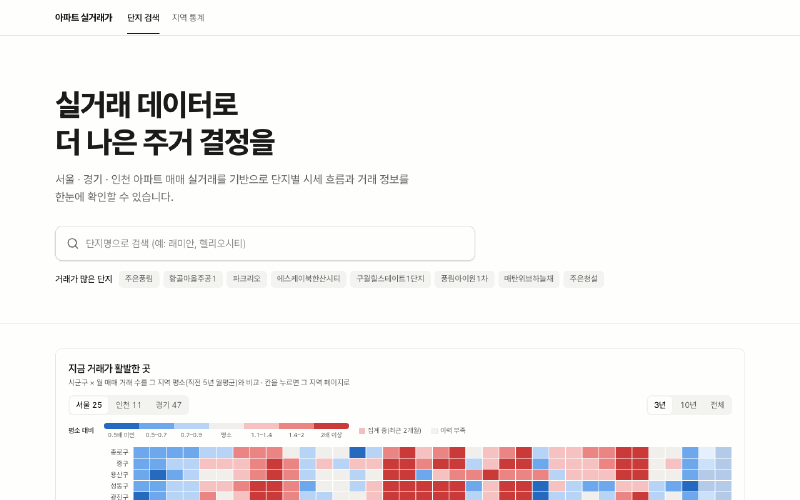

# 아파트 실거래가 탐색기

수도권(서울 · 경기 · 인천) 아파트 매매 실거래 **514만 건(2006–2026)**을 단지 중심으로 탐색하는 서비스입니다. 차트와 대량 테이블의 상호작용, 그리고 그 성능을 측정하며 개선한 과정을 담았습니다.

**https://apt-price-explorer.vercel.app**



- **진입**: 단지 검색(한글 IME 조합 처리 자동완성) · 시군구 × 월 거래 활발도 히트맵(Canvas 직접 구현)
- **단지 상세**: 면적 타입별 거래가 분포(25~75% 밴드) · 중위가 · 역대 최고가 계단선 · 신고가, 기간 선택 → 요약 카드 · 거래 표 · URL 동시 갱신
- **지역**: 단지 목록(정렬) · 통계(3.3㎡당 추이, 법정동 비교) · 거래 탐색(복합 필터 · 서버 정렬 · 무한 스크롤 · 가상화)

## 성능 개선

모두 같은 환경에서 Before / After를 쟀고, 측정 스크립트(`pnpm bench:queries`, `pnpm bench:lh`)로 다시 돌릴 수 있습니다.

| 영역     | 대상                                       |           Before |             After | 무엇을 바꿨나                                                                             | 기록                                                               |
| -------- | ------------------------------------------ | ---------------: | ----------------: | ----------------------------------------------------------------------------------------- | ------------------------------------------------------------------ |
| Frontend | 진입 화면 히트맵 TBT                       |            259ms |          **40ms** | ECharts의 한계(청크 실행 + 2만 칸 처리)를 측정으로 확인 → Canvas 직접 구현 (2.8KB)        | [heatmap](docs/charts/heatmap.md)                                  |
| Frontend | 거래 탐색 5,000행: DOM / 필터 변경 첫 반응 | 60,471 / 1,164ms |    **736 / 33ms** | 병목이 서버(offset)가 아니라 클라이언트임을 확인 → 가상화                                 | [사례 04](docs/performance/cases/04-trade-table-virtualization.md) |
| Frontend | 단지 상세(2,966행) TBT                     |          2,215ms |         **517ms** | 같은 가상화 + 키보드 행 이동                                                              | [사례 04](docs/performance/cases/04-trade-table-virtualization.md) |
| Frontend | 단지 상세 LCP                              |          1,890ms |       **1,487ms** | Suspense 경계를 헤더 / 본문으로 분리 (시뮬레이션 스로틀링이 스트리밍을 못 잡는 함정 포함) | [사례 01](docs/performance/cases/01-suspense-split.md)             |
| Frontend | ECharts 번들 (gzip)                        |            404KB |         **227KB** | 모듈 단위 import + 얇은 래퍼                                                              | [0004](docs/decisions/0004-echarts-thin-wrapper.md)                |
| DB       | 단지 상세 쿼리 3개                         |        134~155ms |         **1~6ms** | 조회 패턴 2개 → 인덱스 2개. 복합(170MB) 대신 단일 열(36MB)로 같은 속도                    | [사례 03](docs/performance/cases/03-transactions-indexes.md)       |
| DB       | 지역 단지 목록                             |            238ms |          **40ms** | `IN + GROUP BY`(순차 스캔) → `LATERAL`, JIT 비용(139ms) 제거                              | [사례 03](docs/performance/cases/03-transactions-indexes.md)       |
| DB       | 면적 타입 쿼리                             |          1,088ms |         **195ms** | 상관 서브쿼리 → 단일 집계 (인덱스 전, 쿼리 구조만의 효과)                                 | [사례 02](docs/performance/cases/02-area-types-query.md)           |
| 운영     | 단지 상세 응답 완료 (Vercel + Neon)        |             2.8s |    **0.43~0.75s** | 위 인덱스                                                                                 | [사례 03](docs/performance/cases/03-transactions-indexes.md)       |
| 데이터   | 정기 갱신 파티션 삭제 / 7개월 재수집       |   264ms / 28.7분 | **0.6ms / 2.0분** | `(sgg_code, deal_date)` 인덱스                                                            | [사례 03](docs/performance/cases/03-transactions-indexes.md)       |
| 데이터   | 운영 DB 증가 (Neon Free 1GB)               |     하루 약 60MB |          **정체** | 용량 감시 알림으로 발견 → 재라벨링 제거 + 갱신 후 VACUUM                                  | [사례 05](docs/performance/cases/05-refresh-churn.md)              |

측정하고 **하지 않기로 한 것**도 기록했습니다: 깊은 offset(3만 행)에서도 40ms대라 keyset pagination 전환 안 함 ([0006](docs/decisions/0006-region-trades-tanstack-query.md)), 콜드 스타트 1.9초는 스켈레톤이 먼저 보여 상시 가동(월 $19) 안 함 ([0002](docs/decisions/0002-infra-vercel-neon.md)).

## 주요 결정

| 결정                                                                                | 요약                                                                                                             |
| ----------------------------------------------------------------------------------- | ---------------------------------------------------------------------------------------------------------------- |
| [0001](docs/decisions/0001-nextjs-fullstack-without-nestjs.md) Next.js 풀스택       | 별도 백엔드 없이 Server Component + Route Handler + 데이터 접근 계층                                             |
| [0002](docs/decisions/0002-infra-vercel-neon.md) Vercel + Neon (Singapore)          | 전체 적재 후 실제 크기로 결정 — 인덱스 포함 약 0.9~1.0GB로 Free(1GB) 유지, 용량 감시 자동화(950MB 이상이면 알림) |
| [0003](docs/decisions/0003-orm-drizzle.md) Drizzle                                  | 동적 필터는 쿼리 빌더, 분석 쿼리(분위수 · window function)는 SQL                                                 |
| [0004](docs/decisions/0004-echarts-thin-wrapper.md) ECharts 얇은 래퍼               | 모듈 단위 등록, 같은 의미 = 같은 색                                                                              |
| [0005](docs/decisions/0005-apartment-detail-data-boundary.md) 단지 상세 데이터 경계 | 통계는 서버 SQL, 단지 하나 · 타입 하나의 거래는 한 번 내려 기간 선택은 서버 왕복 없이                            |
| [0006](docs/decisions/0006-region-trades-tanstack-query.md) 거래 탐색 데이터 요청   | 첫 페이지는 서버 렌더, 이후 TanStack Query 무한 스크롤 (이 탭에서만)                                             |

차트 설계(스케일 · 이상치 · 색): [가격 추이](docs/charts/price-trend.md) · [지역 통계](docs/charts/region-stats.md) · [히트맵](docs/charts/heatmap.md)

## 데이터

- 출처: 국토교통부 아파트 매매 실거래가 (공공데이터포털 API, 시군구 × 계약월 단위 조회)
- 범위: 수도권 83개 시군구, 2006-01 ~ 현재, 거래 5,144,081건 · 단지 19,744개
- 적재: 파티션(시군구 × 월) 단위 교체로 멱등, 원본 응답 캐시 · 재시도 · 일일 호출 예산 ([docs/05](docs/05-data-structure.md))
- 갱신: GitHub Actions 매일 최근 7개월 · 매월 24개월 재수집 → 파생(단지 · 면적 타입 · 월별 집계) → VACUUM → 용량 리포트
- 해제(취소) 거래 정보는 2020-02 이후 계약분부터 제공된다. 최근 1~2개월은 신고 기한(계약 후 30일) 때문에 거래가 늘어날 수 있다.

## 기술 스택

Next.js 16 (App Router, Cache Components) · React 19 · TypeScript · Tailwind CSS 4 · shadcn/ui (Base UI) · ECharts 6 · Canvas 2D · TanStack Table / Query / Virtual · Drizzle ORM · PostgreSQL 17 · Vitest · Vercel · Neon · GitHub Actions · Pretendard

## 로컬 실행

```bash
pnpm install
cp .env.example .env.local      # DATA_GO_KR_SERVICE_KEY 입력
pnpm db:up                      # Docker PostgreSQL 17
pnpm db:migrate && pnpm import:regions   # 수도권 법정동 시드(seed/)를 넣는다
pnpm import:transactions --from 202001 --to 202610 --sgg 11440   # 예: 마포구 일부 기간
pnpm derive                     # 단지 · 면적 타입 · 월별 집계
pnpm dev
```

전체 적재는 API 일일 호출 한도 때문에 여러 날에 나눠 실행한다 (`--max-calls`, `--skip-imported`).

측정: `pnpm bench:queries` (DB 쿼리 11개) · `pnpm bench:lh <url>` (Lighthouse, devtools 스로틀링) · `pnpm db:size`

## 문서

`CLAUDE.md`(프로젝트 원칙) · [`docs/`](docs) — 사용자 흐름(02), 화면 설계(03), 데이터 조사(04) · 구조(05), 아키텍처(06), 기술 스택(07), MVP 계획(08), 결정(decisions), 성능(performance), 차트(charts)
